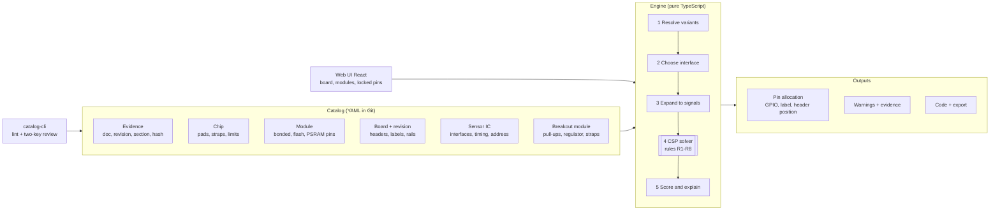
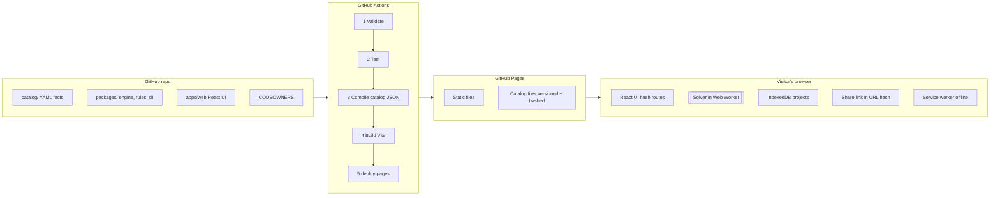

# Universal Pinout Finder — Final Plan

Oct 11, 2026 · @Saad

## Executive summary

Build it, but as a **constraint solver over an evidence-backed catalog**, not a per-pin ranking tool, and start with 6 boards and about 12 modules instead of the whole ecosystem.

The tool answers your three objectives in one pass:

1. **Which pins** a sensor needs, derived from its *breakout module* (not just the IC).
2. **Which interface** to use when the module supports more than one (I2C vs SPI vs UART), chosen by pin cost, bus sharing, speed and address collisions.
3. **Which electrically safe pins** to use, solved for the whole project at once so buses, chip-selects, boot straps and current limits stay consistent.

**Verdict on the GPT master prompt:** its principles are right (datasheet-first, cite every fact, rule engine decides, AI only explains). Its engineering model has six gaps that would produce wrong or unsafe answers: greedy per-pin ranking instead of a project-wide solver, interface choice treated as a side note, boot straps treated as "avoid" instead of "check the resting level", no I2C pull-up or power-budget math, no handling of conflicting sources, and a scope that cannot be verified. Section 3 lists each fix.

The plan was checked against a real project (ESP32-DevKitC V4 + BME280 + RC522 + ST7735S + 4 relays + 4 switches). It fits in exactly 18 pins and uses only one strapping pin, GPIO5, which passes the boot check. The math caught five problems a pinout table would miss (Section 9).

**Deployment:** a fully static site on **GitHub Pages**, built and deployed by GitHub Actions. The solver runs in the visitor's browser, so there is no server to run or pay for (Section 4).

### Decisions locked for this plan

These replace the open questions from the first draft. Each is a default you can change.

| Decision | Choice | Why |
| --- | --- | --- |
| Hosting | GitHub Pages from a **public** repo, custom Actions workflow | Free tier serves public repos only. A custom workflow has no 10 builds/hour cap. |
| Backend | None. Everything runs client-side. | Pages serves static files only, and the solver needs no server. |
| Accounts and storage | No accounts. Projects are saved in the browser (IndexedDB), exported as JSON, or shared as a link. | No personal data is collected, which keeps Pages' usage policy simple |
| Licences | Code under MIT. Catalog facts under CC-BY-4.0, with citations to the original documents. | Datasheet PDFs and vendor images are never redistributed |
| Two-key review | GitHub branch protection: 2 approving reviews required on `catalog/**` via CODEOWNERS | The review rule is enforced by GitHub, not by trust |
| Primary users | Electronics engineers, PCB designers and advanced makers (SIoT first) | Sets the UI's explanation depth |
| First release scope | 6 boards and 12 modules (Section 10) | Verifiable now |

## Research findings

The official documents confirm that pin rules differ by chip, by module, and by board. Each row is a rule the engine must encode, taken from a document opened for this plan. Two items stay **manual**: the ATmega328P and ST7735S PDFs block automated fetching, so a reviewer downloads them by hand in Phase 1. Until then the engine uses the conservative value shown and labels it.

| Family | Fact the engine must encode | Value | Source |
| --- | --- | --- | --- |
| ESP32 | Strapping pins (datasheet) | GPIO0 (pull-up), GPIO2 (pull-down), GPIO12/MTDI (pull-down), GPIO15/MTDO (pull-up), GPIO5 (pull-up). Hold time 1 ms. | [ESP32 Datasheet v5.3](https://documentation.espressif.com/esp32_datasheet_en.pdf) §3, Tables 3-1 to 3-5 |
| ESP32 | GPIO12 at power-on | High selects the 1.8 V VDD\_SDIO LDO. The module datasheet says "IO12 should be kept low when the module is powered on." | Same, §3.2; [ESP32-WROOM-32E Datasheet v2.1](https://documentation.espressif.com/esp32-wroom-32e_esp32-wroom-32ue_datasheet_en.pdf) §4.2, §9 |
| ESP32 | **Source conflict:** GPIO4 | The TRM's GPIO\_STRAP\_REG has 6 strap bits including GPIO4. The datasheet, the module datasheet and ESPHome list 5. | ESP32 TRM v5.8 Register 6.13 vs datasheets; [ESPHome gpio\_esp32.py](https://github.com/esphome/esphome/blob/dev/esphome/components/esp32/gpio_esp32.py) |
| ESP32 | DC levels and drive | VIH ≥ 0.75 × VDD, VIL ≤ 0.25 × VDD, VOH ≥ 0.8 × VDD, VOL ≤ 0.1 × VDD. IOH typ 40 mA (20 mA on VDD\_SDIO pins), IOL typ 28 mA. Pull-ups and pull-downs typ 45 kΩ. | ESP32-WROOM-32E Datasheet v2.1, Table 15 |
| ESP32 | Input-only pins | GPIO34–39: no output driver, no internal pulls | ESP32 TRM v5.8 Table 6.10-1 |
| ESP32 | Erratum GPIO-3.11 | GPIO36/39 inputs are pulled down for about 80 ns when SAR ADC1, ADC2 or AMP power on. All revisions v0.0–v3.1, no fix scheduled. Workaround: ignore those inputs at that moment. | [ESP32 SoC Errata](https://docs.espressif.com/projects/esp-chip-errata/en/latest/esp32/03-errata-description/index.html) |
| ESP32 | Flash and PSRAM pins | GPIO6–11 go to flash. GPIO16/17 are usable only on WROOM/SOLO-1 boards and reserved on WROVER. | [ESP32-DevKitC V4 user guide](https://docs.espressif.com/projects/esp-dev-kits/en/latest/esp32/esp32-devkitc/user_guide.html) |
| ESP32 | ADC effective input range | 100–950 mV (0 dB) up to 150–2450 mV (max attenuation) | ESP32 Datasheet v5.3 §4.9.1 |
| ESP32 | ADC2 vs Wi-Fi | ADC2 = GPIO0, 2, 4, 12–15, 25–27. Unreliable with Wi-Fi on, so analog goes on ADC1 (GPIO32–39). | ESP32 TRM v5.8 Table 6.11-1, §31 |
| ESP32 | SPI speed by routing | IO\_MUX pins: 80 MHz. GPIO matrix: 40 MHz, or about 26.6 MHz with MISO. SPI3 IO\_MUX: CS0 5, SCLK 18, MISO 19, MOSI 23. | [ESP-IDF v6.1 SPI Master](https://docs.espressif.com/projects/esp-idf/en/stable/esp32/api-reference/peripherals/spi_master.html) |
| ESP32 | Cumulative I/O current | 1200 mA absolute max | ESP32 Datasheet v5.3 Table 5-1 |
| ESP32-S3 | Straps | GPIO0, GPIO3 (floating, no pulls), GPIO45 (VDD\_SPI), GPIO46. Hold 3 ms. | [ESP32-S3 Datasheet v2.2](https://documentation.espressif.com/esp32-s3_datasheet_en.pdf) §3 |
| ESP32-S3 | Octal flash/PSRAM | Octal (8-line) flash/PSRAM uses pads from GPIO33–37 (exact pads per module to confirm). GPIO26–32 always go to flash. USB on GPIO19/20. | Same, §2.6, Table 2-14 |
| ESP32-C3 | Straps, glitches, ADC2 | Straps GPIO2, 8, 9. GPIO18 glitches high for about 50 µs at power-up. ADC2 (GPIO5) is "not operable" on some revisions. | [ESP32-C3 Datasheet v2.4](https://documentation.espressif.com/esp32-c3_datasheet_en.pdf) §3, Table 2-2, §4.2.2.1 |
| ESP8266EX | Electrical limits | VIH max 3.6 V, so not 5 V tolerant. 12 mA max per pin. TOUT ADC 0–1.0 V. NRND. | [ESP8266EX Datasheet v7.1](https://documentation.espressif.com/0a-esp8266ex_datasheet_en.pdf) Table 5-1, §4.9 |
| LOLIN D1 mini | Board divider | A0 accepts 3.2 V max. The pin map exists only as an image, so a human transcribes it. | [LOLIN D1 mini V4.0.0](https://www.wemos.cc/en/latest/d1/d1_mini.html) |
| Uno R4 Minima | Pin current | **8 mA per GPIO**, 5 V logic, DAC on A0 | [ABX00080 user manual rev 5](https://docs.arduino.cc/resources/datasheets/ABX00080-datasheet.pdf) §9.3, §7 |
| Uno R3 | ATmega328P limits | **Manual:** the Microchip PDF blocks automated fetch, and the Arduino R3 manual gives no per-pin current. Interim engine value: 20 mA per pin, VIH 0.6 × VCC, labelled "pending manual check". | ATmega328P datasheet DS40002061; [Arduino UNO R3 manual](https://docs.arduino.cc/resources/datasheets/A000066-datasheet.pdf) |
| Pico | Internal pins | GP23 (SMPS PS), GP24 (VBUS sense), GP25 (LED), GP29 = ADC3 = VSYS/3. ADC pins must not exceed IOVDD + about 300 mV while unpowered. | [Pico Datasheet release 21](https://pip-assets.raspberrypi.com/categories/610-raspberry-pi-pico/documents/RP-008307-DS-2-pico-datasheet.pdf) §2.1, §4.2, §4.4 |
| Raspberry Pi 4 | GPIO DC levels | VDD IO = 3.3 V. VIL ≤ 0.8 V, VIH ≥ 2.0 V. VOH ≥ VDD IO − 0.4 V at 2 mA. Default drive 8 mA, max 16 mA. Pulls 18–73 kΩ (typ 47 kΩ). GPIO2/3 = SDA1/SCL1, pulled high by default. | [Raspberry Pi 4 Model B Datasheet rel. 1.1](https://pip-assets.raspberrypi.com/categories/545-raspberry-pi-4-model-b/documents/RP-008341-DS-1-raspberry-pi-4-datasheet.pdf) §4 Tables 2, 3, 5 |
| BME280 | Interface strap | CSB tied to VDDIO = I2C. Once CSB goes low, I2C stays off until power-on reset. Addresses 0x76/0x77 via SDO (must not float). SPI modes 00/11, 10 MHz. Pins max VDDIO + 0.3 V. | [BME280 datasheet rev 1.24](https://www.bosch-sensortec.com/media/boschsensortec/downloads/datasheets/bst-bme280-ds002.pdf) §6.1–6.4, Table 5 |
| MFRC522 | Interface and current | The I2C and EA pins pick I2C, SPI or UART at reset. Supply 2.5–3.6 V. SPI up to 10 Mbit/s. **TVDD current typ 60 mA, max 100 mA**, plus about 16 mA digital/analog. | [MFRC522 rev 3.9](https://www.nxp.com/docs/en/data-sheet/MFRC522.pdf) §8.1.1 Table 5, Table 1 |
| ST7735 family | Display write speed | tSCYCW min 66 ns (about 15 MHz) in both V1.9 and V2.1. Inputs max VDDI + 0.3 V. The ST7735S sheet is manual; until then the engine caps the clock at 15 MHz and labels it. | [Sitronix ST7735 V2.1](https://www.displayfuture.com/Display/datasheet/controller/ST7735.pdf) |
| SRD-05VDC relay | Coil current | 71.4 mA (0.36 W, 70 Ω) or 89.3 mA (0.45 W, 55 Ω). Pick-up ≤ 3.75 V. The engine uses 89.3 mA when the variant is unknown. | [SRD relay datasheet](https://www.circuitbasics.com/wp-content/uploads/2015/11/SRD-05VDC-SL-C-Datasheet.pdf) (secondary host) |
| I2C bus | Pull-up math | Rp(min) = (VDD − 0.4 V)/3 mA. Rp(max) = tr/(0.8473 × Cb). tr max 1000/300/120 ns at 100k/400k/1M. Cb max 400 pF. | [NXP UM10204 rev 7.0](https://www.nxp.com/docs/en/user-guide/UM10204.pdf); [TI SLVA689](https://www.ti.com/lit/an/slva689/slva689.pdf) |

Two lessons for the catalog came out of the research itself. **Document URLs move**: five Espressif and Raspberry Pi links redirected to new hosts during this research. **Some official facts exist only as images.** The catalog therefore needs a content hash for each source and a human-transcription workflow.

## Senior hardware review of the master prompt

Keep the prompt's principles. Replace its engineering model in the 12 places below, because each one would let a "verified" tool give a wrong answer.

| # | What the prompt says | Problem | Change in this plan |
| --- | --- | --- | --- |
| 1 | Rank candidate pins per signal (Step 5) | Greedy picking fails on whole projects. The best SDA pin can steal the only IO\_MUX pin a display needs at 40 MHz. | Solve all signals together as a constraint problem with backtracking (Section 6). Ranking is applied only to complete, valid solutions. |
| 2 | Interface is mentioned as a detected property | Your objective 3 is a real decision. It changes the pin count (I2C adds 0–2 pins, SPI adds 1–4), and the choice is often locked by the breakout. | Interface choice is a first-class solver variable with explicit rules (Section 8). |
| 3 | "Avoid boot-strapping pins" | Too strict and too loose at once. GPIO5 is a fine SPI chip-select because CS idles high, matching its strap default. A relay module with a pull-up on GPIO12 bricks boot. | Model each strap's required reset level and each attached circuit's resting level, and check that they agree (Section 7, R6). |
| 4 | Treats sensors by IC part number | Electrical behaviour belongs to the breakout: regulator, level shifter, onboard pull-ups, which straps are hardwired. The blue RC522 board is SPI-only even though the MFRC522 supports three interfaces. | A two-layer model: an IC record plus module records that wrap it (Section 5). |
| 5 | "Check pull-up requirements" | No math. Five breakouts with 4.7 kΩ pull-ups in parallel give 940 Ω, below the 967 Ω minimum at 3.3 V. | Compute the effective pull-up and rise time per bus (Section 7, R3). |
| 6 | No power budget | Four 5 V relay coils plus a backlit TFT can exceed USB or the board's 3V3 regulator. | Sum current per rail against regulator and USB limits (R7). |
| 7 | Per-pin current "restrictions" | Limits differ about fivefold between boards that look identical: 8 mA on the Uno R4 versus 40 mA absolute on the R3. | Store per-pin, per-port and cumulative limits, and check every load (R4). |
| 8 | Flexible GPIO matrix means "any pin" | On ESP32, routing through the matrix caps SPI at 40 MHz (about 26.6 MHz with MISO) versus 80 MHz on IO\_MUX pins. | Store a routing class per pin-function pair, with the clock limit attached. |
| 9 | One source per fact | Official sources disagree. On ESP32, GPIO4 is a strap in the TRM register but not in the datasheet. | Every fact can carry several pieces of evidence and a `conflict` status. A conflicting pin is treated by its most restrictive reading until a human resolves it. |
| 10 | AI and automated PDF extraction | Extraction output can be published by mistake, and some pin maps are images. | Extraction only proposes drafts. A fact is published only after two reviewers sign off ("two-key"). |
| 11 | Cover every family plus codegen plus PDF import | This cannot be verified in a first release, and a wrong pin from a "verified" tool costs more than a missing board. | Start with 6 boards and about 12 modules, and add families in phases (Section 10). |
| 12 | Treats Raspberry Pi computers like MCUs | On Linux, I2C/SPI/UART pins are fixed by device-tree overlays, Pi 5 uses the RP1 I/O controller, and GPIO2/3 carry I2C with pull-ups enabled by default. | Model each Pi peripheral as an "overlay" option with fixed pins, and pick overlays, not free pins. |

The prompt's evidence model (title, URL, revision, page, claim), its four verification statuses, the warning tiers and the "no safe assignment" result are all kept unchanged.

## System architecture

The product is a static web app on GitHub Pages: a Git-versioned catalog, a pure engine that runs in a Web Worker, and a thin React UI. GitHub Actions validates, tests, compiles and deploys every change. Only the engine decides pins.

### Logical architecture



The catalog changes only through reviewed pull requests. The UI sends the board, modules and locked pins to the engine. The engine's five stages turn them into an allocation where every pin carries its rule trace and evidence links.

### Deployment architecture on GitHub Pages



A push or merged PR triggers the Actions pipeline. Pages serves only static files and versioned catalog JSON. All solving, saving and sharing happens in the visitor's browser.

### Repository layout

One pnpm monorepo. The engine and rules have no UI or network imports, so CI can test them in isolation.

```text
pinout-finder/
├─ catalog/                  # source of truth, reviewed YAML
│  ├─ evidence/              # one file per document: title, rev, URL, sha256, access date
│  ├─ chips/  modules/  boards/
│  ├─ ics/    breakouts/
│  └─ fixtures/              # golden projects written by hand from datasheets
├─ packages/
│  ├─ schema/                # Zod schemas + generated JSON Schema for editors
│  ├─ engine/                # resolve → interface → expand → solve → score → explain
│  ├─ rules/                 # R1–R8, one pure function each
│  ├─ codegen/               # Arduino and MicroPython templates
│  └─ cli/                   # catalog validate | compile | check-links | new-board
├─ apps/web/                 # React + Vite UI and the Web Worker host
├─ .github/
│  ├─ workflows/ci.yml       # every PR: validate, test, build, e2e smoke
│  ├─ workflows/deploy.yml   # push to main: build + deploy to Pages
│  ├─ workflows/links.yml    # weekly: re-check every source URL and hash
│  ├─ CODEOWNERS             # catalog/** → hardware reviewers
│  └─ dependabot.yml         # keeps pinned actions and npm deps current
└─ docs/                     # schema reference, CONTRIBUTING, data provenance
```

### Build and deploy pipeline

1. **Pull request → `ci.yml`.** Installs from the lockfile, then runs `catalog validate` (schema, evidence present, conflicts flagged, three numbering systems on every pin), rule unit tests, property tests, golden fixtures, `vite build`, a Playwright smoke test of the Section 9 project, and a bundle-size check. All are required status checks.
2. **Review.** Branch protection requires 2 approvals on `catalog/**` (the two-key rule) and 1 on code.
3. **Merge to `main` → `deploy.yml`.** Rebuilds, runs `catalog compile` to emit `catalog/<version>.json` plus a manifest (version, date, SHA-256, coverage stats), and copies into `dist/`. Then `actions/upload-pages-artifact` and `actions/deploy-pages` publish it. Previous catalog versions stay in `dist/` so old share links still reproduce.
4. **Weekly → `links.yml`.** Requests every evidence URL and compares redirects and file hashes. On a change it opens an issue, so a reviewer re-checks the affected facts.

```yaml
# .github/workflows/deploy.yml (core)
on: { push: { branches: [main] }, workflow_dispatch: {} }
permissions: { contents: read, pages: write, id-token: write }
concurrency: { group: pages, cancel-in-progress: false }
jobs:
  build:
    runs-on: ubuntu-latest
    steps:
      - uses: actions/checkout@<sha>
      - uses: pnpm/action-setup@<sha>
      - uses: actions/setup-node@<sha>   # node: lts/*, cache: pnpm
      - run: pnpm install --frozen-lockfile
      - run: pnpm catalog validate && pnpm test && pnpm catalog compile
      - run: pnpm --filter web build      # vite base: '/pinout-finder/'
      - uses: actions/configure-pages@<sha>
      - uses: actions/upload-pages-artifact@<sha>
        with: { path: apps/web/dist }
  deploy:
    needs: build
    runs-on: ubuntu-latest
    environment: { name: github-pages, url: '${{ steps.d.outputs.page_url }}' }
    steps:
      - id: d
        uses: actions/deploy-pages@<sha>
```

Actions are pinned to commit SHAs and updated by Dependabot. Version tags move fast: GitHub's own docs and Vite's guide currently show different major versions of the same Pages actions.

### Runtime in the browser

| Part | Technology | Job and reason |
| --- | --- | --- |
| UI shell | React + TypeScript, hash-based routes (`#/board/...`) | Pages has no server rewrite rules, so hash routes avoid 404s on refresh |
| Solver | `packages/engine` in a Web Worker (Comlink) | Keeps the UI responsive. 2 s hard timeout with progress. Deterministic. |
| Catalog | One fetch of `catalog/<version>.json`, cached by hash | Every result records the exact catalog version used |
| Search | MiniSearch over part numbers, nicknames and aliases | "RC522", "MFRC522" and "RFID-RC522" all find the same module, then ask for the variant |
| Board view | SVG generated from header data | Never a copied vendor image (copyright, accuracy) |
| Saved projects | IndexedDB, wrapped in try/catch with an in-memory fallback | Private windows still work |
| Sharing | Project JSON → lz-string → URL hash (`#/p/...`), with the catalog version pinned | No server needed. The recipient sees the same result, or a "re-check against latest catalog" prompt. |
| Export | JSON and CSV in the browser. PDF via a print stylesheet. | No heavy PDF library |
| Offline | Service worker (vite-plugin-pwa) | Works on a bench with no internet |
| Security | Content-Security-Policy in a meta tag, no third-party scripts, no analytics by default | Pages cannot set custom headers, and nothing personal is collected |

### Catalog contribution flow

1. A contributor runs `pnpm catalog new-board esp32-c3-devkitm-1` and fills the YAML, citing evidence IDs.
2. They open a PR. CI rejects any fact without evidence and shows a computed coverage report.
3. CODEOWNERS requests two hardware reviewers. Each checks every fact against the cited page and approves.
4. Merge deploys within minutes, and the board's status badge updates automatically.

The Phase 6 datasheet assistant also stays serverless. pdf.js opens the PDF locally (it is never uploaded), the reviewer selects a pin table, the tool drafts YAML with page anchors, and a button opens a prefilled GitHub PR.

### Non-functional targets

| Target | Value |
| --- | --- |
| App JavaScript (gzip) | ≤ 250 kB |
| MVP catalog JSON (gzip) | ≤ 300 kB, split per family if exceeded |
| Solve time | ≤ 200 ms typical, 2 s hard timeout |
| Accessibility | WCAG 2.1 AA; every warning has a text label and an icon, never colour alone |
| Browsers | Last 2 versions of Chrome, Edge, Firefox, Safari |
| Reproducibility | Same input + same catalog hash = identical output |
| Hosting limits | Site well under Pages' 1 GB cap, deploys well under its 10-minute timeout |

## Data model

Model the hardware in layers, so each fact is stored once at the level where it is true. A pin's final capability is *computed* by stacking the layers, never typed in by hand.

| Layer | Holds | Example |
| --- | --- | --- |
| **Chip** | Pads, each pad's functions with a routing class (IO\_MUX / matrix / fixed), reset pull state, strap role and required level, input-only flag, ADC unit and channel, electrical limits (VIH/VIL/VOH/VOL, mA per pin, cumulative mA, absolute max V) | ESP32: GPIO12 is a strap that must be low for 3.3 V flash |
| **Module** | Which pads are bonded, consumed (flash, PSRAM) or exposed | WROVER-E consumes GPIO16/17 for PSRAM. WROOM-32E does not. |
| **Board + revision** | Header connectors and positions, silkscreen labels, onboard parts that use pins (LED, USB bridge, buttons, dividers, pull resistors), power rails with current capacity | DevKitC V4: J3-10 = GPIO5. D1 mini: A0 has a divider to 3.2 V full scale. |
| **IC (sensor)** | Supported interfaces, signal roles, I/O voltage limits, timing (max SCK, I2C modes), address options, interface-select straps | BME280: CSB selects I2C or SPI. SPI is 10 MHz max. |
| **Breakout module** | Which IC it wraps, its regulator and supply range, level shifting, onboard pull-ups (value), hardwired straps, pin labels, current draw | Blue RC522: SPI hardwired, 3.3 V only |
| **Evidence** | Document title, URL, revision, date accessed, page/section/table, quoted claim, SHA-256 of the file | ESP32 Datasheet v5.3, §3.2 |

Every stored value is a **Fact**, not a bare number, so the engine can refuse to use anything unverified:

```yaml
# catalog/chips/esp32.yaml (excerpt)
pads:
  GPIO12:
    functions:
      - { fn: GPIO, routing: iomux }
      - { fn: SPI2_MISO, routing: iomux, max_mhz: 80 }
      - { fn: ADC2_CH5, routing: fixed }
    strap:
      value: { role: VDD_SDIO_SELECT, required_at_reset: low, default_pull: down }
      evidence: [esp32-ds-v5.3#s3.2, esp32-trm-v5.8#reg6.13]
      status: verified
  GPIO4:
    strap:
      value: { role: unknown, required_at_reset: any }
      evidence: [esp32-trm-v5.8#reg6.13, esp32-ds-v5.3#s3]
      status: conflict            # treated as a strap until a human resolves it
```

Four design rules apply to the schema:

- **Schemas in Zod (TypeScript)**, with the YAML files validated in CI. A catalog PR fails if any fact the engine reads lacks evidence.
- **Status per fact**: `verified` (2 reviewers), `single-source`, `conflict`, `community` (clone boards with no official docs, such as the ESP32-C3 SuperMini), or `missing`. A board's status (fully verified, partial, datasheet required) is computed from the statuses of its facts.
- **Three numbering systems on every pin**: chip GPIO number, board label, and physical connector position. The UI always shows all three side by side.
- **Versioned catalog**: every recommendation records the catalog version and rule-set version, so an old export can be re-checked after a datasheet errata.

## Pin-allocation engine

Treat allocation as a constraint-satisfaction problem (CSP): signals are variables, pins are their domains, and electrical and bus rules are constraints. Problems are small (under about 40 signals and 40 pins), so exact backtracking search finishes in milliseconds and returns a provably valid answer or a provable "no safe assignment".

1. **Resolve variants.** Pin down the board revision and module (WROOM vs WROVER changes GPIO16/17) and each breakout variant. If a variant is ambiguous, stop and ask the user. Do not guess.
2. **Choose interface candidates** per module (Section 8). Each candidate becomes a branch the solver can take.
3. **Expand to signals.** Each signal records its role, direction, drive type (push-pull or open-drain), required peripheral (SPI SCK, I2C SDA, ADC, interrupt-capable input), max clock, shareability (bus line vs exclusive), and resting level at reset (for example, CS idles high).
4. **Build domains.** A pin is in a signal's domain only if all of these hold: it is exposed on this board revision, not consumed by the module or board, supports the function (directly or via the matrix, with the clock limit), and matches direction (no outputs on input-only pins).
5. **Post constraints.**
   - **Exclusive signals** each get their own pin. **Shared bus lines** (SCK, MOSI, MISO, SDA, SCL) are grouped per peripheral instance.
   - Each SPI device gets a unique CS.
   - I2C addresses must be unique per bus. A collision forces the second address strap, a second bus, or SPI.
   - Each UART device gets its own UART instance. UART0 is reserved for USB on boards that use it.
   - ADC channels must be on an ADC unit usable with the radio (ADC1 on ESP32 when Wi-Fi is on).
   - Strap compatibility and electrical rules R1–R8 (Section 7).
   - **Locked pins**: the user's existing assignments are fixed and never moved silently.
6. **Search.** Backtracking with forward checking, choosing the most constrained signal first (fewest legal pins). Use branch-and-bound on the score so the first complete solution sets a bound and the search keeps the best.
7. **Score complete solutions lexicographically**, so a lower tier can never outweigh a higher one:
   - **Tier 1, risk:** count of strap pins used (even compatible ones), JTAG pins, pins with documented power-up glitches, `conflict`-status pins, and pins left floating at reset that drive a load.
   - **Tier 2, performance:** whether SPI clock needs are met via IO\_MUX, and ADC resolution/attenuation fit.
   - **Tier 3, convenience:** library-default pins, physically adjacent header positions, one connector side.
   - **Tier 4, future headroom:** keep scarce capabilities free (ADC1, DAC, touch, spare UART).
8. **Explain.** Every assignment carries a rule trace ("GPIO18: in SPI3 IO\_MUX set \[evidence\], not strap \[evidence\], output-capable"), the top 2–3 alternatives with the tier that ranked them lower, and all warnings.
9. **When unsatisfiable**, extract a minimal conflicting subset of constraints (for example, "5 SPI devices need 5 CS pins, 3 are free"). Then suggest relaxations in order: share a bus, change interface, lower a clock to allow matrix routing, add an MCP23017/PCF8574 expander or ADS1115 ADC, or change board.

The engine is a pure TypeScript package with no UI or network code, so it is deterministic and testable. The same inputs and catalog version always give the same output.

## Electrical validation rules and calculations

Eight rules run on every connection. Each rule passes, passes with a required part (the exact resistor or IC), or blocks the assignment. All numbers below come from the Section 2 sources. The ATmega328P threshold is the one interim value; it is labelled until its manual check is done.

| Rule | What it checks | Failure level |
| --- | --- | --- |
| R1 Absolute max | Highest voltage a driver can put on a pin ≤ the receiver's absolute max (for example BME280 and ST7735 inputs ≤ VDDIO + 0.3 V, ESP8266 VIH ≤ 3.6 V) | Critical |
| R2 Logic thresholds | Driver VOH(min) ≥ receiver VIH(min), and driver VOL(max) ≤ receiver VIL(max), with margin | Critical, or a level shifter is required |
| R3 I2C pull-ups | Effective Rp (all modules in parallel) between Rp(min) and Rp(max) for the chosen bus speed | Warning, with the corrected resistor |
| R4 Pin current | Each load ≤ the per-pin limit. Port, VCC-pin and cumulative sums ≤ their limits. | Critical |
| R5 Dividers | A 5 V signal into a 3.3 V pin needs a divider that stays under VDD at +5% supply and above VIH at −5% | Critical without one |
| R6 Strap compatibility | The circuit's resting level on a strap pin at reset matches the required level for the whole hold time (1 ms ESP32, 3 ms S3/C3) | Warning, or blocked if it would change boot mode or flash voltage |
| R7 Power budget | Sum of currents per rail ≤ regulator rating and USB limit | Warning |
| R8 ADC fit | Sensor output range mapped into the ADC's *effective* range, on a radio-compatible ADC unit | Warning, with the divider values |

### R3: I2C pull-up worked numbers (3.3 V bus)

```latex
R_{p,\min} = \frac{V_{DD} - V_{OL,\max}}{I_{OL}} = \frac{3.3 - 0.4}{3\,\text{mA}} = 967\,\Omega
```

```latex
R_{p,\max} = \frac{t_r}{0.8473\,C_b}
```

| Case | Cb | Speed | Rp(max) | Effective Rp | Result |
| --- | --- | --- | --- | --- | --- |
| One module with 10 kΩ | 50 pF | 400 kHz (tr 300 ns) | 7.08 kΩ | 10 kΩ | **Fails**. Run at 100 kHz, or add 4.7 kΩ in parallel (3.2 kΩ). |
| One module with 10 kΩ | 50 pF | 100 kHz (tr 1000 ns) | 23.6 kΩ | 10 kΩ | Passes |
| Breadboard bus, 4.7 kΩ | 100 pF | 400 kHz | 3.54 kΩ | 4.7 kΩ | **Fails**. Use 2.2–3.3 kΩ. |
| Five breakouts, each 4.7 kΩ | any | any | — | 940 Ω | **Fails Rp(min)**. Remove pull-ups from four of the boards. |

The engine estimates Cb as the sum of each device's pin capacitance (UM10204 allows up to 10 pF per device) plus the MCU pin plus a wiring term from the user's cable length. It shows the estimate so the user can override it. MCU internal pull-ups (tens of kΩ) never count as a valid I2C pull-up at 100 kHz or above.

### R2, R4, R5: other worked checks

- **3.3 V MCU driving a 5 V AVR input:** ESP32 VOH ≥ 0.8 × 3.3 = 2.64 V (WROOM-32E Table 15). A Raspberry Pi 4 gives VOH ≥ 3.3 − 0.4 = 2.9 V. ATmega328P VIH = 0.6 × 5 V = 3.0 V (interim). Both fail worst case, so the engine requires a 74AHCT-family buffer or a level shifter, even though the link often works on a bench.
- **HC-SR04 ECHO (5 V) into ESP32:** a 1 kΩ / 2 kΩ divider gives 5.25 × 0.667 = 3.50 V at +5% supply, above VDD, so it is rejected. A 2.2 kΩ / 3.3 kΩ divider gives 3.15 V high and 2.85 V at −5%, which clears VIH = 0.75 × 3.3 = 2.48 V. Accepted.
- **LED on an Uno R4:** (5 − 2.0 V) / 220 Ω = 13.6 mA, above the 8 mA limit, so it is Critical on the R4. The fix is 470 Ω (6.4 mA). On a Raspberry Pi 4 the same check uses the 8 mA default drive (16 mA max).
- **Bare relay coil from a GPIO:** never driven directly. For an SRD-05VDC of unknown variant the engine uses the worse 89.3 mA coil. With an NPN at forced beta 10, Ib = 8.9 mA, and the worst-case pin high level is VOH(min) = 0.8 × 3.3 = 2.64 V: Rb ≤ (2.64 − 0.7) / 8.9 mA = 217 Ω → 200 Ω (9.7 mA worst case, about 13 mA at 3.3 V, inside the ESP32's 40 mA typical drive). A flyback diode is required. On ready-made relay boards the pin current is set by the board's own base resistor, which the module record stores.
- **Opto-isolated "low-level trigger" relay boards** powered from 5 V: whether a 3.3 V high fully turns off the opto LED depends on that board's schematic. The engine marks the board Caution until its module record has a verified schematic, and recommends JD-VCC separation or a high-level-trigger variant.

### R6: strap check, as a rule

For each strap pin, the engine computes the net's resting level at reset from the internal default pull plus every external pull and every device that drives the line during reset. A pin is allowed only if that level equals the strap's required level, or the strap is marked "any". Examples: an SPI CS on ESP32 GPIO5 passes (CS idles high and GPIO5's strap default is high). A relay input with a 10 kΩ pull-up on GPIO12 is blocked (it would select 1.8 V flash).

### R8: ADC fit example

A 0–5 V sensor on ESP32 ADC1 at max attenuation (effective 150–2450 mV) needs a ratio ≤ 2.45 / 5 = 0.49. A 10 kΩ / 9.1 kΩ divider gives 0.476, so 5 V maps to 2.38 V. The engine also reports the dead zone: sensor values below 0.15 / 0.476 = 0.32 V cannot be read.

## Interface selection

The breakout decides first, then the project. The engine applies these rules in order and shows the user which rule decided:

1. **Module locks.** Only interfaces the *breakout* exposes are candidates. The blue RC522 board hardwires SPI. A 6-pin GY-BME280 exposes CSB and SDO, so both I2C and SPI are possible. A 4-pin version is I2C-only.
2. **Feasibility.** Drop any interface the solver cannot place (for example, no free CS pin, or no free UART instance).
3. **Incremental pin cost.** Prefer the interface that adds the fewest pins *given the current project*, using the table below. When spare pins are not scarce (3 or more free after allocation), a 1-pin difference is ignored and rule 4 decides.
4. **Performance need.** Displays and fast streams (more than about 400 kbit/s, or frame updates) go to SPI. Slow environmental sensors go to I2C.
5. **Conflicts.** An I2C address collision first tries the module's address strap, then a second I2C bus, then SPI if the module supports it.
6. **Wiring distance.** Above about 0.5–1 m, warn for I2C and SPI, and suggest a buffer (for example, P82B715) or a differential bus.
7. **User override** always wins, and the full check reruns.

| Interface | Pins added when the bus already exists | Pins for a new bus | Typical speed | Main risk the engine checks |
| --- | --- | --- | --- | --- |
| I2C | 0 (+1 optional INT) | 2 | 100 kHz / 400 kHz / 1 MHz | Address collisions, pull-up stack (R3), bus capacitance |
| SPI | 1 CS (+ DC, RST, INT as the device needs) | 3 + CS | 10–80 MHz (device and routing limited) | CS count, per-device clock and mode, MISO tri-state |
| UART | Not shareable | 2 + one UART instance | 9.6 k–1 Mbaud | Instance count, TX/RX crossover, UART0/USB conflict, 5 V TX on modules like the AS608 |
| 1-Wire | 0 on an existing line | 1 + 4.7 kΩ pull-up | \~16 kbit/s | Parasite-power strong pull-up, cable length |
| Analog | — | 1 ADC channel | — | ADC unit vs radio, effective range (R8) |

**Worked choice: BME280 in the Section 9 project.** I2C costs 2 pins (no bus exists yet). SPI costs 1 CS on the existing display/RFID bus. Both are feasible. SPI saves one pin, but spare pins are not scarce, so rule 3 does not decide. Rule 4 picks I2C (slow sensor, keeps the SPI bus for the display). It also leaves a bus ready for future sensors at zero pin cost. The engine reports SPI as a valid alternative that saves one pin.

## Worked validation: ESP32-DevKitC V4 project

I ran the plan by hand on your target project. It fits in 18 pins, uses no strapping pin except GPIO5 (where the strap check passes), uses every clean pad (GPIO33 included), and flags five issues with their fixes. Fourteen signals need output-capable pins but only twelve clean pads exist, so exactly two risk pads are unavoidable; the plan uses GPIO5 (strap, passes R6) and GPIO14 (JTAG).

**Inputs:** ESP32-DevKitC V4 with ESP32-WROOM-32E (not WROVER). GY-BME280 6-pin module, blue RC522 module, ST7735S 1.8" SPI module, 4-channel 5 V relay board with transistor inputs, 4 push buttons to GND.

**Pins removed before solving:** GPIO6–11 (flash), GPIO1/3 (UART0 to the USB bridge). Straps 0, 2, 4, 12, 15 are kept as last-resort candidates only.

| Device | Signal | GPIO | Header | Reset state (TRM 6.10-1) | Why this pin |
| --- | --- | --- | --- | --- | --- |
| BME280 | SDA | 21 | J3-6 | Input | Free, not a strap, Arduino-ESP32 default |
| BME280 | SCL | 22 | J3-3 | Input | Same |
| SPI bus | SCLK | 18 | J3-9 | Input | SPI3 IO\_MUX pin (80 MHz path) |
| SPI bus | MOSI | 23 | J3-2 | Input | SPI3 IO\_MUX |
| SPI bus | MISO | 19 | J3-8 | Input | SPI3 IO\_MUX, used by RC522 only (the TFT is write-only) |
| ST7735S | CS | 5 | J3-10 | Pull-up | SPI3 CS0 on IO\_MUX. A strap, but CS idles high = strap default, so R6 passes |
| ST7735S | DC | 16 | J3-12 | Input | Valid only because the module is WROOM |
| ST7735S | RST | 17 | J3-11 | Input | Same |
| RC522 | SDA/CS | 14 | J2-12 | Pull-up | Deselected during boot. JTAG MTMS, so a Caution only if you debug over JTAG. |
| RC522 | RST | 33 | J2-8 | Input disabled, floating | Last clean pad. RST is a logic input, not a load, so floating at reset adds no risk point. |
| Relay 1–4 | IN1–IN4 | 25, 26, 27, 32 | J2-9, J2-10, J2-11, J2-7 | Input disabled, floating | Output-capable, not straps. Floating at boot, so the driver needs a pull-down (below). |
| Switch 1–4 | SW1–SW4 | 34, 35, 36, 39 | J2-5, J2-6, J2-3, J2-4 | Input-only, no pulls | Input-only pins are ideal for buttons and keep output pins free. External pull-ups required. |

### What the checks found

- **Passed.** No flash, UART0 or input-only conflict. One IO\_MUX SPI bus serves both devices with per-device clocks: ST7735 ≤ 15 MHz, RC522 ≤ 10 Mbit/s. All logic is 3.3 V, so no level shifting is needed. Only the RC522 drives MISO (the TFT is write-only), so MISO sharing cannot conflict in this project.
- **1. Warning: I2C rise time.** If the GY-BME280 carries 10 kΩ pull-ups, 400 kHz fails (Rp(max) 7.08 kΩ at 50 pF). Fix: run at 100 kHz, or add 4.7 kΩ to 3V3 (3.2 kΩ effective).
- **2. Warning: relays floating at boot.** GPIO25/26/27/32 reset with input disabled and no pull, so a relay board without a base pull-down can click during boot. Fix: 10 kΩ to GND on each IN, unless the module record shows one.
- **3. Warning: 5 V budget.** Four SRD-05VDC coils draw 4 × 89.3 = 357 mA worst case (286 mA for the 0.36 W variant) on the USB 5 V rail, before the ESP32 and TFT backlight. Fix: a separate 5 V supply for the relay board, grounds tied.
- **4. Warning: 3V3 budget.** The MFRC522 alone can draw up to 119 mA (TVDD 100 mA + IDDD 9 mA + IDDA 10 mA max), on top of the ESP32's radio peaks and the TFT. The engine compares the rail total with the board record's regulator rating. Fix: add 10 µF next to the RC522, and use a separate 3.3 V regulator if the total exceeds the rating.
- **5. Caution: erratum GPIO-3.11.** SW3/SW4 on GPIO36/39 can see an 80 ns low pulse whenever SAR ADC1, ADC2 or AMP powers on. Fix: confirm each button press after a 10 ms software debounce (which ignores 80 ns pulses), or poll instead of using raw edge interrupts.
- **Required parts.** 4 × 10 kΩ pull-ups for the switches (GPIO34–39 have no internal pulls). Optional 100 nF per switch for hardware debounce.
- **Variant sensitivity.** Switch the module to WROVER-E and GPIO16/17 disappear. The solver then moves DC/RST to GPIO13 (JTAG) and GPIO2 (strap; the TFT reset input does not drive it, so R6 passes). GPIO4 is avoided because its `conflict` strap status would add a second risk point.

```cpp
// Generated from the allocation above (Arduino-ESP32)
constexpr int PIN_I2C_SDA = 21, PIN_I2C_SCL = 22;        // BME280 @ 0x76/0x77, 100 kHz
constexpr int PIN_SPI_SCK = 18, PIN_SPI_MOSI = 23, PIN_SPI_MISO = 19;
constexpr int PIN_TFT_CS = 5, PIN_TFT_DC = 16, PIN_TFT_RST = 17;   // ST7735S <= 15 MHz
constexpr int PIN_RFID_CS = 14, PIN_RFID_RST = 33;                  // MFRC522 <= 10 MHz
constexpr int PIN_RELAY[4]  = {25, 26, 27, 32};          // 10k pull-down if module lacks one; separate 5 V supply
constexpr int PIN_SWITCH[4] = {34, 35, 36, 39};          // external 10k pull-ups to 3V3
constexpr uint32_t DEBOUNCE_MS = 10;                     // also masks erratum GPIO-3.11 on 36/39
```

## MVP catalog and roadmap

The first release covers 6 boards and 12 modules, chosen so that every hard rule type (straps, input-only pins, routing limits, 5 V vs 3.3 V, 8 mA pins, board dividers) appears at least once.

| MVP boards | Why it is in the first set |
| --- | --- |
| ESP32-DevKitC V4 (WROOM-32E and WROVER-E variants) | Straps, input-only pins, IO\_MUX vs matrix, module-dependent pins |
| ESP32-S3-DevKitC-1 (N8 and N8R8) | Octal PSRAM consumes pads in GPIO33–37, native USB |
| Arduino Uno R3 | 5 V logic, fixed peripheral pins, 40 mA absolute per pin |
| Arduino Uno R4 Minima | Same shape as R3, but 8 mA per pin |
| Raspberry Pi Pico / Pico W | Internal GP23–25/29, wireless chip takes pins on the W |
| LOLIN D1 mini V4 | D-label mapping, 0–3.2 V A0 divider, 12 mA pins |

**MVP modules:** BME280 (GY 4-pin and 6-pin, Adafruit), MPU-6050 (GY-521), SSD1306 I2C OLED, ST7735S SPI TFT, MFRC522 blue board, DS18B20, DHT22, HC-SR04, ADS1115, 5 V relay board (transistor and opto variants), push button, potentiometer.

**Phases.** Each phase ends with a gate that must pass before the next begins:

1. **Foundation (weeks 1–2):** pnpm monorepo, Zod schemas, evidence model, `catalog validate`, `ci.yml` and `deploy.yml`, branch protection and CODEOWNERS. A placeholder page goes live on GitHub Pages in week 1, so deployment is never a late risk. *Gate:* a PR with a fact lacking evidence fails CI, and the Pages URL serves the build from `main`.
2. **Catalog + engine (weeks 3–7):** MVP boards and modules entered with two-reviewer sign-off, including regulator ratings and radio peak currents in the board records. The ATmega328P and ST7735S PDFs are downloaded by hand to replace the interim values. Interface selection, CSP solver, rules R1–R8, explanation traces. *Gate:* the Section 9 project and 20 golden fixtures reproduce exactly, and property tests find no invalid solution.
3. **Web app (weeks 8–11):** board picker, module search with variant prompts, constraints screen with locked pins, results with the SVG header view, solver in a Web Worker, IndexedDB projects, share links, JSON/CSV export, offline support. *Gate:* five real users complete a 3-device project unaided, and a WCAG 2.1 AA audit passes.
4. **Code generation (weeks 12–13):** Arduino and MicroPython templates with pinned library versions, using only the allocated pins. *Gate:* generated sketches compile in CI for each MVP board.
5. **v1.0 launch (week 14):** `links.yml`, CONTRIBUTING and schema docs, a bench check on real MVP boards, and a version tag. *Gate:* every engine-flagged boot failure reproduces on the bench.
6. **Coverage expansion (ongoing):** ESP32-C3/C6 DevKits, NodeMCU, Mega 2560, Nano 33 IoT, Nano ESP32, Pico 2, then Raspberry Pi 4/5 (overlay model). Community boards like the C3 SuperMini enter with `community` status. *Gate per board:* every exposed pin is verified or explicitly marked.
7. **Datasheet assistant (later):** in-browser pdf.js drafts YAML with page anchors and opens a prefilled PR. It never publishes on its own.

**Stack:** pnpm workspaces, TypeScript (strict), React + Vite, Zod, Vitest, fast-check, Stryker (mutation tests), Playwright, MiniSearch, Comlink, idb-keyval, lz-string and vite-plugin-pwa. It is deployed by GitHub Actions to GitHub Pages, with no server in any phase.

## Test plan and acceptance criteria

The tests check the engine against the datasheets, not against its own past output. Five layers, all in CI:

| Layer | What it proves | Example |
| --- | --- | --- |
| Catalog lint | Every fact the engine reads has evidence. No pin lacks its GPIO/label/position. Board status matches its facts. | A PR adding D1 mini D5 without a source fails |
| Rule unit tests | Each of R1–R8 passes and fails at its exact datasheet boundary | 940 Ω effective pull-up fails, 967 Ω passes. A 1 k/2 k divider on HC-SR04 is rejected, 2.2 k/3.3 k is accepted. |
| Golden fixtures | Known projects give known allocations, written by a human from the datasheet before the engine runs | The Section 9 project. Uno R4 LED at 220 Ω is flagged. Pico W never gets GP23–25/29. |
| Property tests (fast-check) | For random projects, every returned solution satisfies every hard constraint, and "unsatisfiable" really is unsatisfiable (cross-checked by brute force on small cases) | Never a flash pin, never an output on GPIO34–39, never two CS on one pin, locked pins never move |
| Mutation tests | Deleting any rule makes at least one test fail | Removing R6 breaks the GPIO12 pull-up fixture |

The master prompt's 18 test categories map onto these layers. Category 16 (revision-specific mapping) uses WROOM vs WROVER on DevKitC V4. Category 13 (unknown part) must return "datasheet required", never a guess.

A **hardware bench check** runs before each catalog release: on real MVP boards, boot with the risky circuits the engine flags (pull-up on GPIO12, load on GPIO0) and confirm that the predicted failure happens. This catches catalog errors that no software test can.

### Acceptance criteria for the MVP

- [ ] The Section 9 project returns the allocation, warnings and evidence links shown there.
- [ ] Every pin in every result links to at least one evidence record with document, revision and section.
- [ ] Changing WROOM to WROVER, or Uno R3 to R4, changes the result as the datasheets require.
- [ ] An over-subscribed project returns "no safe assignment", the minimal conflict, and at least one suggested fix.
- [ ] Locked pins are never moved without explicit permission.
- [ ] Unverified or conflicting facts are always visible in the result, labelled in words, not only by colour.
- [ ] Generated code compiles and uses only the allocated pins.

## Risks and open questions

The largest risk is a confident wrong answer, so every mitigation below works by showing uncertainty, not hiding it.

| Risk | Impact | Mitigation |
| --- | --- | --- |
| Catalog error in a "verified" fact | User damages a board or loses boot | Two-reviewer sign-off enforced by branch protection, bench checks, an errata feed, and a catalog version on every result so affected projects can be re-checked |
| Clone and breakout variance (pull-ups, regulators, pin order) | Right IC, wrong module behaviour | Module records per vendor, a variant prompt, and `community` status backed by a photo or schematic |
| Source drift (5 URLs redirected during this research) | Broken citations | Content hash per source, weekly `links.yml` check that opens an issue |
| Copyright on datasheets and diagrams | Takedown | Store facts and citations only. Never redistribute PDFs or vendor images. Draw headers from data. pinout.xyz is CC-BY-SA-4.0, so it is not imported. |
| GitHub Pages usage policy | Pages forbids running an online business or commercial SaaS | Keep it a free tool. If SIoT ever monetises it, the same static build deploys unchanged to Cloudflare Pages or Netlify. |
| Free plan needs a public repo | Catalog and code are public | Public by design. Keep internal SIoT notes in a separate private repo. |
| Service worker serves an old catalog | Stale results | Versioned catalog filenames, plus an "update available" prompt when the manifest changes |
| Share links after catalog updates | Old link, new facts | Keep old catalog versions in the site and offer "re-check against latest" |
| Scope creep to "every board" | Unverifiable catalog | Phase gates, and each board's status shown in the picker |
| Liability | Trust | A clear disclaimer and the evidence trail on every result |

**Remaining manual actions (Phase 2, before catalog entry):**

- [ ] Download the ATmega328P datasheet (DS40002061) by hand and replace the interim 20 mA / 0.6 × VCC values.
- [ ] Download the Sitronix ST7735S datasheet by hand and confirm the 66 ns write cycle carries over from the ST7735.
- [ ] Add the 3V3 regulator rating to each board record from its official schematic (DevKitC V4 first).
- [ ] Confirm Raspberry Pi board-level pull-up values on GPIO2/3 from the official schematics.
- [ ] Confirm MFRC522 MISO tri-state behaviour before allowing it on a bus with another MISO device.

## Sources

These pages were opened for this plan on 11 Oct 2026. Section 2 gives the exact section and table for each fact.

- [ESP32 Series Datasheet v5.3](https://documentation.espressif.com/esp32_datasheet_en.pdf), Espressif
- [ESP32-WROOM-32E / 32UE Datasheet v2.1](https://documentation.espressif.com/esp32-wroom-32e_esp32-wroom-32ue_datasheet_en.pdf), Espressif
- ESP32 Technical Reference Manual v5.8, Ch. 6 (IO MUX and GPIO Matrix), Espressif (local copy, Tables 6.10-1 and 6.11-1, Register 6.13)
- [ESP32 Series SoC Errata, GPIO-3.11](https://docs.espressif.com/projects/esp-chip-errata/en/latest/esp32/03-errata-description/index.html), Espressif
- [ESP32-S3 Series Datasheet v2.2](https://documentation.espressif.com/esp32-s3_datasheet_en.pdf), Espressif
- [ESP32-C3 Series Datasheet v2.4](https://documentation.espressif.com/esp32-c3_datasheet_en.pdf), Espressif
- [ESP8266EX Datasheet v7.1](https://documentation.espressif.com/0a-esp8266ex_datasheet_en.pdf), Espressif
- [ESP32-DevKitC V4 User Guide](https://docs.espressif.com/projects/esp-dev-kits/en/latest/esp32/esp32-devkitc/user_guide.html), Espressif
- [ESP-IDF v6.1 SPI Master Driver](https://docs.espressif.com/projects/esp-idf/en/stable/esp32/api-reference/peripherals/spi_master.html), Espressif
- [LOLIN D1 mini V4.0.0](https://www.wemos.cc/en/latest/d1/d1_mini.html), WEMOS
- [Arduino UNO R4 Minima User Manual (ABX00080) rev 5](https://docs.arduino.cc/resources/datasheets/ABX00080-datasheet.pdf), Arduino
- [Arduino UNO R3 User Manual (A000066)](https://docs.arduino.cc/resources/datasheets/A000066-datasheet.pdf), Arduino
- [Raspberry Pi Pico Datasheet, release 21](https://pip-assets.raspberrypi.com/categories/610-raspberry-pi-pico/documents/RP-008307-DS-2-pico-datasheet.pdf), Raspberry Pi
- [Raspberry Pi 4 Model B Datasheet, release 1.1](https://pip-assets.raspberrypi.com/categories/545-raspberry-pi-4-model-b/documents/RP-008341-DS-1-raspberry-pi-4-datasheet.pdf), Raspberry Pi
- [BME280 Data Sheet rev 1.24](https://www.bosch-sensortec.com/media/boschsensortec/downloads/datasheets/bst-bme280-ds002.pdf), Bosch Sensortec
- [MFRC522 Product Data Sheet rev 3.9](https://www.nxp.com/docs/en/data-sheet/MFRC522.pdf), NXP
- [ST7735 Datasheet V2.1](https://www.displayfuture.com/Display/datasheet/controller/ST7735.pdf) and [V1.9](https://www.displayfuture.com/Display/datasheet/controller/ST7735S.pdf) (file named ST7735S but contains ST7735), Sitronix via third-party host
- [SRD relay datasheet](https://www.circuitbasics.com/wp-content/uploads/2015/11/SRD-05VDC-SL-C-Datasheet.pdf) (secondary host)
- [UM10204 I2C-bus specification rev 7.0](https://www.nxp.com/docs/en/user-guide/UM10204.pdf), NXP
- [SLVA689 I2C Bus Pullup Resistor Calculation](https://www.ti.com/lit/an/slva689/slva689.pdf), Texas Instruments
- [ESPHome ESP32 pin validation (gpio\_esp32.py)](https://github.com/esphome/esphome/blob/dev/esphome/components/esp32/gpio_esp32.py), ESPHome
- [Pinout.xyz repository](https://github.com/pinout-xyz/Pinout.xyz) (CC-BY-SA-4.0)
- [GitHub Pages limits](https://docs.github.com/en/pages/getting-started-with-github-pages/github-pages-limits), GitHub
- [Using custom workflows with GitHub Pages](https://docs.github.com/en/pages/getting-started-with-github-pages/using-custom-workflows-with-github-pages), GitHub
- [Vite: Deploying a static site](https://vite.dev/guide/static-deploy), Vite
